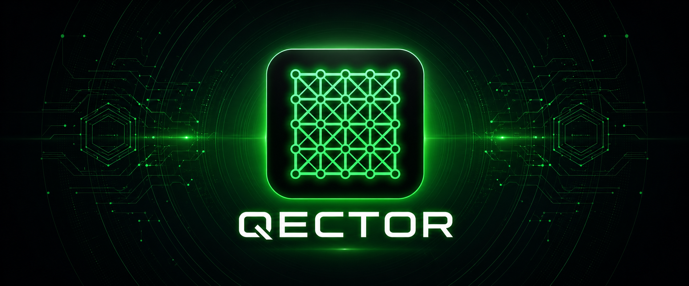

<p align="center">
  
</p>

<h1 align="center">QECTOR Decoder v3</h1>

<p align="center">
  <strong>Quantum error correction decoding for Python, with a compiled Rust core.</strong><br/>
  Union-Find, exact MWPM, BP-OSD for LDPC/qLDPC codes, CPU and GPU batch decoding, Stim and Sinter integration.
</p>

<p align="center">
  <a href="https://pypi.org/project/qector-decoder-v3/"></a>
  <a href="https://pypi.org/project/qector-decoder-v3/"></a>
  <a href="https://github.com/GuillaumeLessard/qector-decoder/actions/workflows/tests.yml"></a>
  <a href="https://github.com/GuillaumeLessard/qector-decoder/blob/main/LICENSE"></a>
</p>

<p align="center">
  <a href="https://qector.store/">Website</a> ·
  <a href="https://qector.store/pricing/">Pricing</a> ·
  <a href="https://github.com/GuillaumeLessard/qector-decoder/blob/main/CHANGELOG.md">Changelog</a> ·
  <a href="https://github.com/GuillaumeLessard/qector-decoder/releases">Releases</a> ·
  <a href="mailto:admin@qector.store">Contact</a>
</p>

---

## Overview

QECTOR Decoder v3 decodes syndromes from quantum error-correcting codes. Every
decoder returns a correction `c` that reproduces the syndrome, `H c = s (mod 2)`,
and the same graph can be handed to several decoder families so they can be
compared on identical input.

- **Decoder families:** Union-Find, exact Blossom (MWPM), sparse Blossom,
  BP-OSD and Relay-BP for LDPC/qLDPC, belief matching, ambiguity clustering,
  two-stage X/Z decoding, lookup tables and hybrid cascades.
- **Batch decoding** on CPU (Rayon) and, with a commercial licence, on CUDA or
  OpenCL GPUs, plus an `AutoDecoder` that falls back across backends.
- **Ecosystem:** Stim detector error models, Sinter custom decoders, a
  PyMatching-compatible `Matching` shim and a qiskit-qec plugin.
- **Tooling:** the `qector` CLI, the `qector-doctor` environment diagnostic, and
  a local MCP server for AI assistants.

## Installation

```bash
pip install qector-decoder-v3
```

Binary wheels are published for **CPython 3.9 to 3.14** on:

| Platform | Wheel tag |
| --- | --- |
| Linux x86_64 | `manylinux_2_17_x86_64` |
| Windows x64 | `win_amd64` |
| macOS Apple silicon | `macosx_11_0_arm64` |

There is no source distribution: the Rust core is distributed as compiled
wheels only, so other platforms (Linux aarch64, musllinux, macOS x86_64) are
not supported by `pip install`.

Optional extras:

```bash
pip install "qector-decoder-v3[stim]"   # Stim, Sinter, PyMatching and LDPC ecosystem
pip install "qector-decoder-v3[all]"    # full validation environment
```

## Quick start

```python
import numpy as np
from qector_decoder_v3 import UnionFindDecoder, BlossomDecoder

check_to_qubits = [[0, 1], [1, 2], [2, 3], [3, 4]]   # repetition code, 5 qubits
syndrome = np.array([0, 1, 0, 0], dtype=np.uint8)

print(UnionFindDecoder(check_to_qubits, 5).decode(syndrome))   # fast, approximate
print(BlossomDecoder(check_to_qubits, 5).decode(syndrome))     # exact MWPM
```

### Batch decoding

```python
from qector_decoder_v3 import BatchDecoder, CUDABatchDecoder

syndromes = np.random.default_rng(0).integers(0, 2, size=(4096, 4), dtype=np.uint8)
corrections = BatchDecoder(check_to_qubits, n_qubits=5).parallel_batch_decode(syndromes)

if CUDABatchDecoder.is_available():                 # requires a paid licence and a CUDA driver
    corrections = CUDABatchDecoder(check_to_qubits, 5).batch_decode(syndromes)
```

`AutoDecoder` picks the best available backend and falls back automatically if
one fails:

```python
from qector_decoder_v3 import AutoDecoder

auto = AutoDecoder(check_to_qubits, n_qubits=5)
corrections = auto.batch_decode(syndromes)
print(auto.available_backends(), auto.last_backend)
```

### From a Stim circuit

```python
import stim
from qector_decoder_v3 import dem

circuit = stim.Circuit.generated(
    "surface_code:rotated_memory_z", distance=5, rounds=5,
    after_clifford_depolarization=0.005,
)
graph = dem.from_stim(circuit.detector_error_model(decompose_errors=True)).collapse_to_graph()

decoder = graph.make_decoder("blossom")   # carries the DEM's weights
# also: "union_find", "fast_union_find", "sparse_blossom", "bp_osd",
#       "lookup_table", "hybrid_cascade", "ambiguity_cluster"
```

When decoding circuit-level noise on a GPU, pass the weights
(`graph.weights()`) as `edge_weights`: unweighted cluster growth cannot tell a
rare error mechanism from a common one.

### BP-OSD for qLDPC codes

```python
from qector_decoder_v3 import codes
from qector_decoder_v3.bposd import BpOsdDecoder

# [[144,12,12]] bivariate bicycle code: A = x^3 + y + y^2, B = y^3 + x + x^2
cx, cz = codes.bivariate_bicycle_code(
    12, 6, [("x", 3), ("y", 1), ("y", 2)], [("y", 3), ("x", 1), ("x", 2)]
)
H = cx.parity_check_matrix()
decoder = BpOsdDecoder(H, error_rate=0.01, osd_order=0)
```

### Sinter

```python
import sinter
import stim
from qector_decoder_v3.sinter_compat import qector_sinter_decoders


def main():
    tasks = [
        sinter.Task(
            circuit=stim.Circuit.generated(
                "surface_code:rotated_memory_z", distance=d, rounds=d,
                after_clifford_depolarization=0.004,
            ),
            json_metadata={"d": d},
        )
        for d in (3, 5)
    ]
    stats = sinter.collect(
        num_workers=4, tasks=tasks,
        decoders=["qector_blossom", "qector_unionfind"],
        custom_decoders=qector_sinter_decoders(),
        max_shots=10_000, max_errors=100,
    )
    for s in stats:
        print(s.decoder, s.json_metadata, s.errors, "/", s.shots)


if __name__ == "__main__":   # required: Sinter starts worker processes
    main()
```

Registered decoder names: `qector_blossom`, `qector_unionfind`,
`qector_unionfind_unweighted`, `qector_bposd`, `qector_belief`. A complete,
tested walkthrough is at https://qector.store/getting-started/.

Available decoders: `qector_blossom`, `qector_unionfind`,
`qector_unionfind_unweighted`, `qector_bposd`, `qector_belief`.

## Decoder families

| Decoder | Use | Status |
| --- | --- | --- |
| `UnionFindDecoder`, `FastUnionFindDecoder` | Low-latency approximate decoding | Stable |
| `BlossomDecoder` | Exact minimum-weight perfect matching | Stable |
| `SparseBlossomDecoder` | Near-optimal matching on large graphs | Experimental |
| `BpOsdDecoder` (BP-OSD, Relay-BP) | LDPC / qLDPC codes | Experimental |
| `BeliefMatching` | Correlated noise, accuracy over speed | Research |
| `AmbiguityClusterDecoder`, `TwoStageDecoder` | qLDPC clusters; X/Z sectors decoded separately | Experimental |
| `ColourCodeDecoder` | Colour codes (BP-OSD on the hypergraph) | Experimental |
| `BatchDecoder`, `DecoderPool` | CPU batch and multi-process decoding | Stable |
| `CUDABatchDecoder`, `OpenCLBatchDecoder`, `CUDABpOsdDecoder` | GPU batch decoding (paid licence) | Hardware dependent |
| `AutoDecoder` | Backend selection with automatic fallback | Stable |
| `SpaceTimeDecoder`, `SlidingWindowDecoder`, `StreamingDecoder` | Multi-round and streaming decoding | Experimental |
| `HybridDecoder`, `LookupTableDecoder` | Union-Find/Blossom routing; small codes | Experimental |
| `NeuralPredecoder`, `GNNPredecoder` | Learned predecoders | Research |

## Command line and MCP server

```bash
qector --help          # decode, bench, serve
qector-doctor          # explains why a backend is or is not available
```

The package includes a Model Context Protocol server (JSON-RPC 2.0 over stdio)
that exposes 13 decoding tools to MCP clients such as Claude Code:

```bash
python -c "import qector_decoder_v3; qector_decoder_v3.run_mcp_server()"
```

A ready-made client configuration is in `mcp.json`. The MCP, REST and gRPC
servers are intended for local and controlled use; they are not hardened for
public exposure.

## Licensing

QECTOR Decoder v3 is source-available under the
[PolyForm Noncommercial License 1.0.0](https://github.com/GuillaumeLessard/qector-decoder/blob/main/LICENSE)
(SPDX `PolyForm-Noncommercial-1.0.0`).

- **Free:** personal, academic and other non-commercial use. Universities,
  public research organisations, charities and government institutions may use
  it free whatever their source of funding.
- **Commercial licence required:** use by or for a company, including company
  work under a research contract, hosted or SaaS deployment, OEM integration and
  redistribution. Plans start at $79/month, with a 14-day money-back guarantee:
  [qector.store/pricing](https://qector.store/pricing/).

### Activating a licence

Tokens are Ed25519-signed and verified offline against a public key compiled
into the package: no licence server and no network access, so they work on
air-gapped machines.

```bash
export QECTOR_LICENSE_KEY="<token>"
export QECTOR_LICENSE="<token>"
python -c "import qector_decoder_v3 as q; print(q.get_license_info()['tier'])"   # Pro or Enterprise
```

A key file also works: `QECTOR_LICENSE_FILE=/path/to/license.key`, or
`~/.qector/license.key`.

| Tier | Plans | GPU batch decoders | Code-distance tier |
| --- | --- | --- | --- |
| Community | no token | not available | 7 |
| Pro | Pro, Pro Perpetual, Pilot | available | 19 |
| Enterprise | Lab, Enterprise | available | 63 |

CPU decoding is never blocked. Distance tiers are advisory unless
`QECTOR_ENFORCE=1` is set.

| Variable | Effect |
| --- | --- |
| `QECTOR_SILENT=1` | Hides the licensing notice printed on import |
| `QECTOR_ENFORCE=1` | Turns distance tiers into hard errors |
| `QECTOR_OFFLINE=1` | Refuses every outbound billing call (decoding never uses the network) |
| `QECTOR_CUDA_DEVICE_ID` | CUDA device to use (default `0`) |
| `QECTOR_OPENCL_DEVICE_ALLOW` | Comma-separated substrings selecting OpenCL devices |
| `QECTOR_BLOSSOM_K_MULT` | Sparse-MWPM candidate multiplier (default `2.0`); lowering it can reduce matching quality |

## Limitations

- For standard surface-code MWPM, PyMatching is faster than the exact
  `BlossomDecoder`; QECTOR's focus is decoder breadth and qLDPC coverage.
- `SparseBlossomDecoder` is near-optimal, not exact; use `BlossomDecoder` when
  exactness matters.
- GPU speed-ups depend on hardware and workload, and unweighted GPU kernels
  trade accuracy for throughput.
- No performance figures are published: throughput and logical error rates
  depend on your hardware, code, distance and noise model.

## Release integrity

Wheels are built, tested on Linux, Windows and macOS, and published to PyPI by
GitHub Actions using Trusted Publishing. Each GitHub Release lists the wheels'
SHA-256 digests, and every wheel carries Sigstore build provenance:

```bash
gh attestation verify qector_decoder_v3-<version>-<tag>.whl --repo GuillaumeLessard/qector-decoder
```

Security reports: see [SECURITY.md](https://github.com/GuillaumeLessard/qector-decoder/blob/main/SECURITY.md).

## Citation

```bibtex
@software{lessard2026qector,
  author  = {Guillaume Lessard},
  title   = {{QECTOR Decoder v3}: Quantum Error Correction Decoding for Python},
  year    = {2026},
  version = {1.0.1},
  url     = {https://qector.store/},
  note    = {Source-available under PolyForm Noncommercial 1.0.0}
}
```

Related records on Zenodo:
[architecture and foundations](https://doi.org/10.5281/zenodo.21941046) ·
[verification bundle](https://doi.org/10.5281/zenodo.22046403) ·
[user manual](https://doi.org/10.5281/zenodo.21363016) ·
[Workbench](https://doi.org/10.5281/zenodo.21360433).

## Related projects

- [QECTOR Workbench](https://github.com/qectorlab/qector-decoder-workbench-windows/releases/latest): free desktop application (Windows, Linux, macOS)
- [QECTOR Claude plugin](https://github.com/GuillaumeLessard/qector-claude-plugin): QEC tools for Claude Code and Claude Desktop

## Contact

- Commercial licensing and support: [admin@qector.store](mailto:admin@qector.store)
- Bugs and questions: [GitHub Issues](https://github.com/GuillaumeLessard/qector-decoder/issues)
- Sponsor development: [GitHub Sponsors](https://github.com/sponsors/qectorlab)

© 2026 Guillaume Lessard / iD01t Productions. Licensed under PolyForm Noncommercial 1.0.0.
